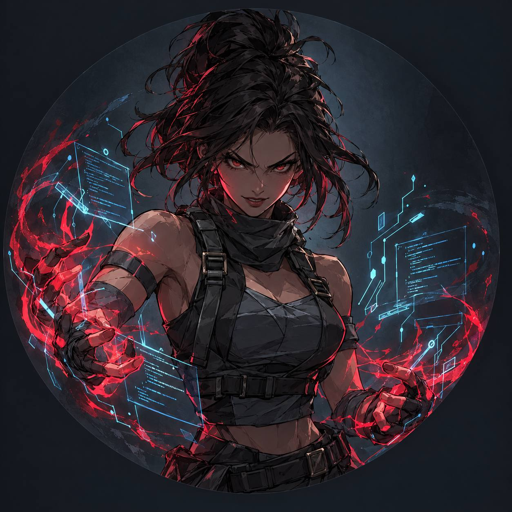

# Hey, I'm Omnia 👋

  

### AI / ML Engineer | Learning by building 🤖

I'm a Computer Science graduate from Mansoura University, interested in AI and Machine Learning.

I like learning new concepts and trying them out in real projects. I'm especially interested in understanding how models work, improving their performance, and turning ideas into something useful.

- 🤖 Exploring Machine Learning, Deep Learning, and Computer Vision
- 🛠️ Working with Python and building AI applications
- 📚 Always learning, experimenting, and improving one project at a time

---

## 🚀 Some Things I've Worked On

### 📊 IBM HR Attrition Analysis
A machine learning project where I explored employee attrition data, compared different models, and evaluated their performance.

- Compared 4 machine learning models
- Used 5-fold cross-validation
- Test ROC-AUC: **0.805**
- Test Accuracy: **79.6%**

🔗 [Check out the project](https://github.com/syncverse12/AI-SyncVerse)

### 🏛️ Egyptian Landmark Recognition
A computer vision project focused on recognizing Egyptian landmarks using image embeddings and similarity search with CLIP.

🔗 [Try it on Hugging Face](https://huggingface.co/spaces/Omnia0/egypt-landmark-recognition-t)

*Still a work in progress — the demo may hit inference quota limits.*

### 🧑‍💼 Employee Attrition Intelligence
Part of my graduation project work, focused on the AI side of employee attrition analysis and model explainability.

- Worked with XGBoost and SHAP
- Explored attrition predictions and promotion-readiness insights

🔗 [Explore the API](https://omnia0-employee-attrition.hf.space/docs)

---

## 🧰 Tools I Use

**Languages & Data**

**AI & Machine Learning**

**Building & Deployment**

---

## 📜 Certifications

- 🎓 [**Neural Networks and Deep Learning**](https://coursera.org/verify/J7SIG8WH9243) — DeepLearning.AI / Coursera, May 2026
- 🤖 [**Digital Egyptian Pioneers Initiative (DEPI) — AI Track**](https://www.linkedin.com/in/omnia-elsaka/overlay/1770482140495/single-media-viewer?profileId=ACoAAFSxJYQBGwmG1JKSjQLFC5XuO-gIzo9S_7c)
- 🌍 [**Business English Track — Round 3**](https://drive.google.com/file/d/1z4WzHRi0aYk5g2BBwewj92If8KLxmj57/view) — Digital Egyptian Pioneers, OTO Courses (Jun–Dec 2025)
- 💡 [**AI Career Essentials**](https://savanna.alxafrica.com/certificates/NG8e6hrfJy) — ALX Africa
---

## 📊 A Little GitHub Corner

  
  

---

## 📫 Let's Connect!

---

  

  <i>Learning, building, making mistakes, and figuring things out along the way. 🐍💚</i>

